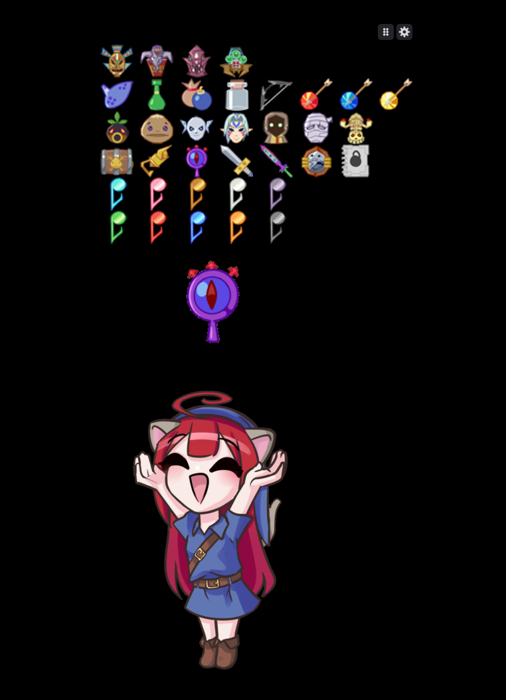

# Pushitracker

<p align="center">
  
</p>

## Download

Get the latest version from the [Releases page](https://github.com/Pushigoh/Pushitracker/releases/latest).

## Build

Needs Go 1.27+.

```
build.bat
```
## Folders

Put these next to `pushitracker.exe`:

```
pushitracker.exe
characters/
  <character>/      optional; each image can be a .gif, .png or .jpg
    idle.gif        shown at rest
    reward.gif      shown when an icon is clicked
    <n>.gif         shown instead of reward.gif for icon <n> (optional)
    talk.gif        shown instead of idle while you talk (optional)
    reward_talk.gif, <n>_talk.gif   the same while talking during a reward (optional)
    <game>/         reward and <n> images for one game only, named like its games/ folder (optional)
games/
  <game>/
    icons/
      0.png         item display when nothing is clicked (optional)
      <row>/<n>.png               one icon; each folder is one row; a .gif plays
      <row>/<n>-1.png, <n>-2.png  an icon with several stages
    gifs/
      <n>.gif       shown when icon <n> is clicked
    overlays/       optional; each image can be a .gif, .png or .jpg
      <name>.png    drawn behind everything else
      <n>.png, <n>-1.png, <n>-2.png   named like an icon's stages: shown while the icon is on that stage
      <n>-0.png     shown while icon <n> isn't collected; without it, its first stage shows in grey
settings/
```

Icons can have any name; the same name finds the icon's gif, the character's image and the icon's overlays. Icons, rows and overlays are sorted alphabetically, ignoring case, with numbers in order (2 before 10).

## Controls

- Click an icon to collect it, or move it to its next stage. Right-click it to clear it.
- Drag the grip to move everything.
- Shift+drag the character, the item or an overlay to move it.
- Ctrl+drag an icon to move just that icon, or Alt+drag it to move its whole row.
- Ctrl+Z undoes the last move.
- The gear opens the settings. Save keeps sizes and positions for this game.

## Talking character

Choose a microphone in setup or in the settings panel, where a bar shows how loud it is. When it gets louder than the Open threshold (the white line on the bar), a character with a talk image shows it instead of idle. It keeps talking until the mic has been quieter than the Close threshold (the grey line) for the Talk hold time.

